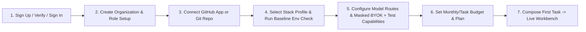

# P0 — UX Flows & Wireframe Architecture

- **Document ID:** `DOC-P0-UX-001`
- **Owner:** Frontend & Product Design
- **Date:** 2026-11-13

## 1. End-to-End Customer Onboarding Flow



## 2. Core Screens & Navigation Shell

```text
+-----------------------------------------------------------------------------------+
| AI SDLC Studio   [Org Switcher v]   [Region: us-east]   [Credits: $48.20] [User] |
+-------------------+---------------------------------------------------------------+
| Navigation        | Active View                                                   |
| - Dashboard       |                                                               |
| - Tasks           | [Task Composer / Workbench]                                   |
| - Repositories    |   Header: Task Title | Repo(s) | Base SHA | Cost | Cancel     |
| - Models & Budget |   16-Stage Pipeline Stepper (SSE Live Cursor + Reconnect)     |
| - Billing         |   Tabs:                                                       |
| - Team & RBAC     |     [1. Spec & Diff]  [2. QA & TestPlan]  [3. Plan & Budget]  |
| - Audit & Data    |     [4. Verification & AC Traceability]   [5. Review & PR]    |
| - Support (Op)    |                                                               |
| - Help & Status   |   Action Bar (RBAC-gated): [Approve Digest] [Request Changes] |
+-------------------+---------------------------------------------------------------+
```

## 3. Critical UI Integrity Rules
1. **No Optimistic Lie:** UI never marks an approval, cancel, publish, or billing mutation as succeeded until backend returns `2xx` with persisted state/digest.
2. **Digest & Scope Visibility:** Every approval button explicitly displays the target `repo_commit_sha`, `spec_sha256` / `plan_sha256` / `patch_sha256`, and cost reservation before confirmation.
3. **Recovery Guidance:** Error banners separate `WAITING_INPUT`, `WAITING_BUDGET`, `BASELINE_STALE`, `BLOCKED_ENVIRONMENT`, and `STALE_APPROVAL` with direct one-click recovery buttons (`Revise Spec`, `Top Up Budget`, `Refresh Baseline`, `Reload Latest Version`).
4. **Secret Masking:** Raw API keys, webhook secrets, and session tokens never render in UI tables, tooltips, or network responses after initial input.
