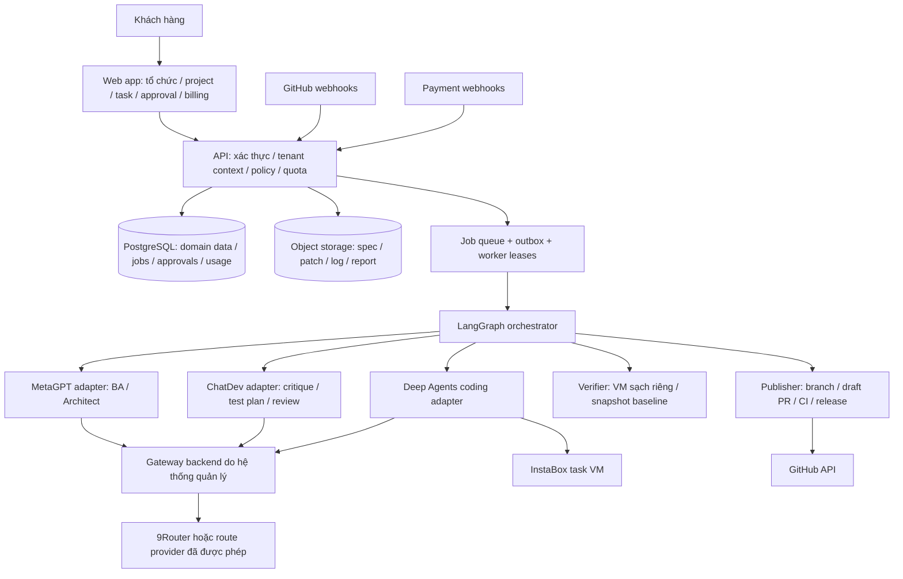

# AI SDLC SaaS — roadmap đến bản phát hành sử dụng thương mại

Ngày lập: 2026-11-13. Đối tượng đã được người dùng chọn: **SaaS phục vụ nhiều khách hàng độc lập**.

Tài liệu này là kế hoạch thực hiện và tiêu chí phát hành, chưa phải tuyên bố các tính năng đã hoàn thành.
P0–P14 bên dưới là các phase của sản phẩm; khác với Phase 1/2 của Spike 01.
Mỗi phase chỉ hoàn tất khi có bằng chứng kiểm chứng, tài liệu và luồng giao diện tương ứng.

## 1. Đích đến của sản phẩm

Khách hàng đăng ký, tạo tổ chức, kết nối repository, cấu hình model và ngân sách,
giao một yêu cầu bằng ngôn ngữ tự nhiên, duyệt spec/kế hoạch, theo dõi quá trình
thực hiện, nhận bản thay đổi đã kiểm chứng và pull request để review/merge.
Họ có thể dừng, tiếp tục sau lỗi, sửa yêu cầu, quản lý thành viên, xem chi phí,
xuất hoặc xóa dữ liệu mà không phải chạy lệnh PowerShell hay nhờ người vận hành sửa database.

Phạm vi GA đề xuất để xây đầy đủ và kiểm chứng được:

- GitHub Cloud, repository public/private, nhiều repository trong một project.
- Python và TypeScript/JavaScript là hai nhóm stack có support profile chính thức.
- Bugfix, feature, refactor và docs/test task; khởi tạo dự án mới từ template đã kiểm chứng.
- Yêu cầu liên quan nhiều repo được chia thành subtasks, mỗi repo có baseline/branch/PR riêng.
- Spec, test plan, execution plan, diff, báo cáo kiểm chứng, review và release notes có phiên bản.
- Tài khoản/tổ chức, phân quyền, subscription/quota, usage, audit và hỗ trợ vận hành đầy đủ.
- Preview/staging nằm trong môi trường cô lập; bước merge/release/production có quyền và approval riêng.

P0 phải chốt danh sách framework, kích thước repo, cấu hình test và giới hạn vận hành
được hỗ trợ. Một sản phẩm GA cần công bố rõ support matrix và hành vi từ chối repo
ngoài support matrix, thay vì hứa xử lý mọi ngôn ngữ/hạ tầng.

## 2. Điểm xuất phát đã kiểm chứng

| Hạng mục | Trạng thái có bằng chứng | Phần còn thiếu để dùng trong SaaS |
| --- | --- | --- |
| 9Router local + nhiều model | Phase 1 live PASS với Dev và Reviewer | Gateway production, tenant routing, quota, metering, credential boundary |
| Deep Agents + InstaBox adapter | Tạo VM, shell/file tools, timeout, cleanup đã chạy live | Job/resource ledger, hủy/phục hồi, orphan cleanup qua nhiều tiến trình |
| Bugfix trên fixture | Phase 2 live PASS, baseline 4/4, post 19/19, 14 case Red→Green | Repo thật, stack profiles, acceptance oracle độc lập, nhiều tình huống lỗi |
| Static gates và verifier | Đã có code/test và một lần live hoàn chỉnh | Policy theo project, review ngoại lệ, kiểm tra chống bypass, báo cáo thương mại |
| `src/ai_sdlc/contracts.py` | Đã có domain contracts, version/digest, approval/report helpers | Audit, schema compatibility, tenant/run identifiers, API persistence và tests sản phẩm |
| `repo_context.py`, `repo_policy.py`, `model_routing.py` | Đã có module trong `src/ai_sdlc` | Kiểm chứng trên repo thật, tenant isolation, tích hợp service |
| MetaGPT / ChatDev | Đã khảo sát, chưa có tích hợp native được chứng minh trong workspace | Adapter riêng, phiên bản pin, test workflow thực, vận hành dịch vụ |
| Web app/API sản phẩm, IAM, billing | Chưa có bằng chứng triển khai trong workspace | Xây theo roadmap |

Nguồn nội bộ: [Phase 1](phase-1-live-smoke.md), [Phase 2](phase-2-live-smoke.md),
[version matrix](version-matrix.md). Số lượng unit test không thay thế tiêu chí nghiệm thu sản phẩm.

## 3. Kiến trúc mục tiêu



### Quyết định kỹ thuật đề xuất

- **API và core:** Python/FastAPI, giữ domain types hiện có trong `src/ai_sdlc`;
  thêm validation/JSON Schema ở biên API, không viết lại toàn bộ dataclass chỉ để đổi framework.
- **Frontend:** React + TypeScript, UI dùng API và event stream; có thể triển khai static assets trên CDN.
- **Workflow:** LangGraph tự host với persistent checkpointer, worker process riêng với web API.
- **Dữ liệu SaaS:** PostgreSQL cho domain data và execution ledger. SQLite của 9Router
  vẫn là nội bộ gateway, không dùng làm database chung của SaaS.
- **Queue:** ban đầu có thể dùng jobs/outbox/leases trên PostgreSQL; chỉ thêm broker riêng
  khi load test hoặc nhu cầu scheduling chứng minh cần. Worker và API vẫn scale độc lập.
- **Artifacts:** object storage private; local disk chỉ là cache có thể mất.
- **MetaGPT và ChatDev:** service/container/venv độc lập, giao tiếp qua HTTP/JSON hoặc job protocol.
- **Coding:** dùng phương án 1A đã kiểm chứng: Deep Agents + InstaBox. Tái sử dụng phần Open SWE
  có nguồn gốc/giấy phép rõ ràng; không coi đây là đã chạy nguyên khối Open SWE/Robin.
- **Development:** 9Router local như hiện tại. **Production:** gateway nằm trong môi trường
  do backend vận hành, không phụ thuộc laptop hoặc `localhost` của khách hàng.
- **Gateway isolation:** không giả định 9Router có sẵn ranh giới tenant. Backend broker quyết định
  credential/route/quota; BYOK cần cấu hình cô lập theo tenant. Nếu gateway không đảm bảo
  điều đó, dùng instance riêng hoặc route provider trực tiếp qua cùng adapter.
- **Triển khai:** dev/staging/production tách DB, secrets, storage, gateway và sandbox credentials.
  Web frontend có thể dùng Cloudflare/Vercel; worker dài hạn chạy container phù hợp với thời lượng task.

LangGraph hỗ trợ checkpoint để tiếp tục thread và interrupt cho bước chờ người duyệt;
đây là primitive thực thi, không tự cung cấp authorization hoặc idempotency nghiệp vụ.
[Persistence](https://docs.langchain.com/oss/python/langgraph/persistence),
[interrupts](https://docs.langchain.com/oss/python/langgraph/interrupts).

## 4. Pipeline một nhiệm vụ từ đầu đến cuối

| Bước | Xử lý | Output / điều kiện chuyển bước |
| --- | --- | --- |
| 1. Intake | Nhận yêu cầu, actor, tenant, project, repo, branch, budget | Task hợp lệ; đủ quyền và quota |
| 2. Route & risk | Xác định task type, độ rủi ro, support profile, các repo liên quan | Chọn workflow và các approval bắt buộc |
| 3. Repo context | Đọc baseline repo, dependency, conventions, test commands, module liên quan | RepoContext gắn commit SHA/tree digest |
| 4. BA | MetaGPT hỏi làm rõ, viết mục tiêu/non-goals/acceptance criteria/design | TaskSpec có schema version và spec digest |
| 5. QA spec | ChatDev phản biện, sinh TestPlan, đánh dấu câu hỏi/rủi ro | Tiêu chí có phương pháp kiểm chứng; blockers được xử lý |
| 6. Spec approval | Người có quyền duyệt đúng spec/context/test-plan version | Approval record bất biến, có actor/time/digest |
| 7. Dev plan | Lập implementation plan và subtasks theo repo | Plan gắn spec, baseline, model/policy version |
| 8. Plan approval | Kiểm tra scope, file nhạy cảm, chi phí ước tính, quyền tools | Approval đúng phiên bản; đủ budget reservation |
| 9. Baseline | Chuẩn bị VM, chạy checks có sẵn, chụp pre-agent snapshot | Baseline reports và resource ledger |
| 10. Tests trước | Tạo regression/acceptance tests, chạy trên baseline | Red hợp lệ hoặc ngoại lệ đã duyệt có lý do |
| 11. Implement | Dev sửa code, kiểm tra từng bước, sửa lỗi có giới hạn | Candidate patch và thực thi từng acceptance criterion |
| 12. Independent verification | Static gates; Red/Green ở môi trường sạch riêng; lint/type/build/E2E theo profile | Verification report có exit codes, artifacts và traceability |
| 13. Review | Reviewer nhận spec + diff + bằng chứng, phân loại findings | Findings resolve hoặc trả lại Dev / SpecChangeRequest |
| 14. Delivery approval | Người duyệt bản thay đổi đúng patch digest/commit | Cho phép publish branch/draft PR với phạm vi đã duyệt |
| 15. PR & CI | Publisher tạo/cập nhật PR; đọc CI/review feedback; xử lý thay đổi baseline | PR, CI checks, release notes và trạng thái rõ ràng |
| 16. Close & cleanup | Chốt usage, dọn resources, giữ artifacts theo retention, thông báo | Task terminal; tài nguyên còn sót luôn được theo dõi |

Task nhỏ có thể đi đường rút gọn theo policy đã duyệt: tái sử dụng template spec,
bỏ các vòng thảo luận không cần thiết. Task nào cũng giữ acceptance, commit binding,
authorization, budget và verification. Task rủi ro không được tự phân loại thấp để bỏ approval.

Các nhánh cần có từ đầu:

- Thiếu yêu cầu → `WAITING_INPUT`; không đoán các quyết định nghiệp vụ quan trọng.
- Chờ duyệt → `WAITING_APPROVAL`; worker nhả lease và tài nguyên được pause/cleanup theo policy.
- Spec không khả thi → `SpecChangeRequest`; phiên bản mới hủy hiệu lực approval cũ.
- Repo thay đổi → `BASELINE_STALE`; cập nhật context và chạy/duyệt lại theo mức ảnh hưởng.
- Test/review lỗi → quay lại Dev trong giới hạn attempts/time/token/cost.
- Hết budget → `WAITING_BUDGET` hoặc dừng an toàn theo policy; không đổi model đắt hơn ngầm.
- Mất liên lạc khi đang chạy lệnh → trạng thái chưa rõ, reconcile; không chạy lại thao tác ghi mù quáng.
- Người dùng hủy → ngừng dispatch bước mới, kết thúc tác vụ đang chạy khi có thể, rồi cleanup.
- Cleanup thất bại → lưu `cleanup_status=FAILED` bên cạnh kết quả task, cảnh báo và janitor xử lý tiếp.

## 5. Những ràng buộc xuyên suốt

1. Mọi resource thuộc khách hàng có `tenant_id`: DB rows, checkpoints, jobs, caches,
   vector/memory nếu có, object keys, sandbox/snapshot, GitHub installation, usage và logs.
2. Backend xác định tenant từ identity/membership. Client gửi tenant ID không đủ để được truy cập.
3. Model output, source code, test code, README, log và webhook đều là dữ liệu không tin cậy.
4. Agent không tự cấp quyền, tự duyệt approval, lấy credential tenant khác hay gọi control-plane API.
5. Approval gắn `tenant/project/run + base SHA + spec/test-plan/plan/patch digest + policy version`.
   Nội dung hoặc quyền thay đổi thì kiểm tra lại approval liên quan.
6. Graph state/checkpoints là trạng thái thực thi; domain DB là nguồn sự thật về task,
   authorization, approvals và usage. UI đọc projection đã reconcile, không có hai nơi tự đổi phase.
7. Queue xử lý ít nhất một lần: mọi side effect quan trọng có intent/idempotency key,
   external resource ID và reconciliation. Không hứa exactly-once cho API bên ngoài.
8. Không lưu raw secret trong prompt, frontend, checkout, report, URL hay log.
9. Artifact và kết quả kiểm chứng không được agent sửa sau khi đánh giá; publisher dùng đúng digest đã review.
10. State `PASS` có phạm vi bằng chứng rõ ràng; model đánh giá tích cực không thay thế checks chạy thật.

## 6. Roadmap theo phase

### P0 — Chốt yêu cầu sản phẩm, support matrix và thiết kế SaaS

**Phụ thuộc:** bằng chứng Spike 01 hiện có.

- [ ] Viết PRD: personas owner/developer/reviewer, nhu cầu, user journeys và loại task hỗ trợ.
- [ ] Chốt stack/framework GA, multi-repo policy, repo size, timeouts và cơ chế preview/release.
- [ ] Chốt nguồn model production: account của nền tảng, BYOK, quyền sử dụng phù hợp và cách cung cấp dịch vụ.
- [ ] Xác minh InstaBox đáp ứng provisioning/snapshot/quota/region/egress/concurrency và isolation cần thiết.
- [ ] Chốt data regions, retention, export/delete, support policy và quy trình xử lý dữ liệu khách hàng.
- [ ] Thiết kế tenancy, approval boundaries, sandbox trust boundaries và nguồn sự thật của trạng thái.
- [ ] Chọn payment provider phù hợp với pháp nhân/thị trường; chốt cách tính phí và chính sách task thất bại.
- [ ] Lập UX flows/wireframes và backlog có acceptance criteria, dependencies, owner và evidence link.
- [ ] Rà soát license, dependency và phần code trích xuất từ ba dự án; lập danh mục third-party notices.

**Đầu ra:** PRD, architecture decisions, support matrix, threat model, data policy, backlog.

**Nghiệm thu:** mỗi use case có đầu vào/đầu ra/quyền/ngân sách/điểm dừng rõ ràng;
khả năng multi-tenant của các dependency là điều đã kiểm tra hoặc có phương án cô lập thay thế.

### P1 — Nền code sản phẩm, contracts và khung API/UI

**Phụ thuộc:** P0.

- [ ] Đóng gói `src/ai_sdlc`; pin runtime/dependencies và tách domain/adapters/API/worker.
- [ ] Audit và tái sử dụng `contracts`, `repo_context`, `repo_policy`, `model_routing` hiện có.
- [ ] Thêm tenant/project/task/run/attempt IDs, schema version, provenance và migration cho contracts.
- [ ] Định nghĩa RepoContext, TaskSpec, TestPlan, ExecutionPlan, SpecChangeRequest,
  ApprovalRecord, VerificationReport, ReviewReport và ExecutionReport.
- [ ] Định nghĩa API version, error codes, pagination, idempotency và event payloads; xuất OpenAPI.
- [ ] Dựng frontend shell: navigation tổ chức/project/task/settings, loading/error/empty states.
- [ ] Tạo test fixtures cho serialization, digest binding và compatibility giữa versions.
- [ ] Thiết lập kiểm tra source: lint/type/test/build, dependency scan và secret scan trong môi trường phát triển.
- [ ] Giữ regression fixtures từ spike; mỗi lần chuyển utility sang core đều kiểm tra hành vi tương đương.

**Đầu ra:** package core, API/UI skeleton, contracts có version và generated API client.

**Nghiệm thu:** checkout sạch cài/build được theo tài liệu; cùng payload cho cùng digest;
payload cũ có migration hoặc lỗi version rõ ràng; người dùng mở được app và nhận lỗi có nghĩa.

### P2 — Tài khoản, tổ chức, phân quyền và dữ liệu tenant

**Phụ thuộc:** P1. Đây là cổng bắt buộc trước khi tiếp nhận dữ liệu nhiều khách hàng.

- [ ] Đăng ký/đăng nhập/logout, xác minh tài khoản, khôi phục, quản lý session và thu hồi session.
- [ ] Tạo tổ chức, mời thành viên, đổi vai trò, rời tổ chức, chuyển owner và khóa tài khoản.
- [ ] Áp dụng RBAC: Owner, Admin, Developer, Reviewer, Viewer; tách quyền billing và publish/merge.
- [ ] Thiết kế PostgreSQL migrations cho tenants/memberships/projects/repos/tasks/runs/approvals/audit.
- [ ] Tenant scoping ở API, worker, query layer, checkpoints, object storage, events và caches.
- [ ] PostgreSQL RLS là lớp bảo vệ bổ sung; runtime DB role không dùng owner/superuser/BYPASSRLS.
- [ ] Composite constraints ngăn liên kết project/repo/run giữa hai tenant.
- [ ] Tenant context ở connection pool/transaction phải được set và reset đúng; test reuse connection.
- [ ] Frontend có organization switcher, invitation/membership screens và thông báo thiếu quyền.
- [ ] Audit mọi hành động nhạy cảm; quyền người đang bị thu hồi phải bị kiểm tra lại khi resume/publish.

**Đầu ra:** nền tảng identity + tenancy hoạt động xuyên API/worker/storage.

**Nghiệm thu:** tenant A không truy cập được tài nguyên B qua ID đoán được, URL artifact,
SSE, resume endpoint, queue, cache hoặc GitHub binding; bộ test cross-tenant bắt buộc pass.
RLS cần cấu hình đúng vì DB owner và `BYPASSRLS` có thể vượt policy.
[PostgreSQL row security](https://www.postgresql.org/docs/current/ddl-rowsecurity.html).

### P3 — Kết nối repository, project profiles và RepoContext

**Phụ thuộc:** P2.

- [ ] GitHub App installation/uninstallation, chọn repo, xác nhận tenant được sở hữu installation.
- [ ] Scope token theo repo và quyền tối thiểu; webhook ký, deduplicate, xử lý mất quyền/repo đổi tên.
- [ ] Cho phép nhiều repo trong project, default branch và cấu hình branch protection tương ứng.
- [ ] Lấy source tại commit bất biến; không upload secrets hoặc theo symlink ra ngoài vùng cho phép.
- [ ] Repo profiles cho Python và JS/TS: install, test, lint, type-check, build, integration/E2E.
- [ ] Chuẩn bị ephemeral DB/service cho integration tests theo recipe, không truy cập DB production.
- [ ] Mở rộng RepoContext: symbols/module/interfaces, conventions, dependencies, liên kết file/line/SHA.
- [ ] Đặt giới hạn file size/context size, cache theo tenant/repo/commit; invalidation khi source thay đổi.
- [ ] UI kiểm tra kết nối, chọn branch/profile và chạy environment validation có báo cáo.
- [ ] Luồng tạo project mới dùng template versioned, kiểm tra license và chạy baseline checks trước nhận việc.

**Đầu ra:** project thực có source baseline, profile kiểm tra chạy được và context có bằng chứng.

**Nghiệm thu:** onboard repo private Python và repo JS/TS thật; baseline tái lập được;
uninstall GitHub App làm dừng quyền truy cập; unsupported profile bị báo rõ trước khi tốn tiền chạy agent.
GitHub hỗ trợ thu hẹp repository/permission khi tạo installation token.
[Installation authentication](https://docs.github.com/en/apps/creating-github-apps/authenticating-with-a-github-app/authenticating-as-a-github-app-installation).

### P4 — Gateway model production, routing theo vai trò và ngân sách

**Phụ thuộc:** P2; dùng project policy từ P3.

- [ ] Chuyển cấu hình 9Router local thành provider adapter có cùng interface với gateway production.
- [ ] Model catalog/allowlist và mapping BA/Architect/Dev/Tester/Reviewer theo tenant/project.
- [ ] Kiểm tra chat, tool calling và structured output riêng theo route; model xuất hiện trong catalog chưa đủ.
- [ ] Secret references và backend credential broker; BYOK được mã hóa, che trong UI và không vào prompt/VM.
- [ ] Dùng route/gateway config cô lập tenant; không expose dashboard 9Router cho khách hàng SaaS.
- [ ] Freeze model/prompt/compression policy vào từng run; lưu route thực tế khi router fallback.
- [ ] Giới hạn context/output, request rate, concurrency, retries, wall time và provider cooldown.
- [ ] Budget reservation trước dispatch, đo usage từng attempt, settle/release sau kết thúc.
- [ ] Tách input/output/cache usage, estimated vs confirmed cost; thiếu usage không được tự coi là miễn phí.
- [ ] UI kiểm tra model, quyền xem cấu hình, usage và cảnh báo budget; thay đổi model/routing có audit.
- [ ] Đo chất lượng khi bật RTK/Headroom/prompt injectors; cấu hình theo workflow, tránh đổi ngầm trong run.

**Đầu ra:** cùng pipeline dùng được nhiều model, có budget và truy nguyên request.

**Nghiệm thu:** tenant chỉ gọi được route được phép; một tenant không dùng quota/key tenant khác;
kiểm tra overspend do concurrency, route lỗi và budget bị cạn. Production vẫn hoạt động khi laptop dev tắt.

### P5 — Job engine bền vững, LangGraph orchestration và resource lifecycle

**Phụ thuộc:** P1–P4.

- [ ] Graph cho intake/context/spec/QA/approval/plan/execute/verify/review/publish/cleanup.
- [ ] Persistent checkpointer, tenant-bound thread/run IDs, node/attempt version và schema migration.
- [ ] Transactional outbox, jobs queue, worker leases/heartbeats, retry/backoff và dead-letter handling.
- [ ] Domain task states và graph execution state có projection/reconciliation rõ ràng.
- [ ] Approvals là server-side authorization + digest binding; xử lý double-click, stale approval và concurrent updates.
- [ ] Sandbox/snapshot/resource ledger ghi intent, idempotency key, ownership, lease, TTL và provider IDs.
- [ ] Hủy/resume/retry/restart-from-stage có ngữ nghĩa khác nhau; side effects không lặp mù quáng.
- [ ] Orphan sweeper/janitor chạy độc lập: máy, snapshot, preview, token và artifact hết hạn.
- [ ] Event stream có sequence/cursor, reconnect, tenant filtering và không giữ worker chờ UI.
- [ ] UI task timeline, trạng thái chờ duyệt/input/budget, cancel và resume ngay từ phase này.

**Đầu ra:** một task tiếp tục được qua restart, mất mạng và approval dài hạn.

**Nghiệm thu:** kill API/worker tại các điểm tạo VM, gọi model, chờ duyệt và publish intent;
khởi động lại không sinh job/PR/charge trùng, không quên resource, không tiếp tục với quyền đã bị thu hồi.
Thiếu acknowledgement phải được coi là kết quả chưa rõ.
[LangGraph fault tolerance](https://docs.langchain.com/oss/python/langgraph/fault-tolerance).

### P6 — MetaGPT native adapter: BA, Architect và spec approval

**Phụ thuộc:** P3–P5.

- [ ] Pin source/version MetaGPT và dựng service riêng phù hợp dependencies.
- [ ] Adapter sử dụng action/role thực của MetaGPT; không chỉ gắn tên MetaGPT lên một prompt riêng.
- [ ] Chứng minh model BA/Architect đi qua gateway chung với tenant/usage context đúng.
- [ ] Đọc RepoContext trước khi tạo spec; output JSON phải validate cấu trúc và kiểm tra semantic binding.
- [ ] Có vòng hỏi người dùng khi thiếu dữ kiện, giới hạn retry parse và số vòng refine.
- [ ] Spec chứa goal, non-goals, AC có ID, edge cases, expected interfaces, file/module ảnh hưởng và risks.
- [ ] Versioning/spec diff, sửa tay trong UI, approve/reject/request changes và audit.
- [ ] Tự hủy hiệu lực approval liên quan khi sửa spec/baseline; giữ nguyên lịch sử cũ để truy vết.
- [ ] Bộ eval BA có yêu cầu mơ hồ, mâu thuẫn, vượt scope và repo có kiến trúc hiện hữu.

**Đầu ra:** nhập yêu cầu trên web → MetaGPT tạo spec sát repo → người dùng duyệt đúng phiên bản.

**Nghiệm thu:** service gọi MetaGPT thật qua 9Router trong test integration có budget;
spec không chỉ đúng JSON mà còn gắn bằng chứng repo; spec chưa duyệt không thể dispatch Dev qua API.
Nguồn dự án: [MetaGPT](https://github.com/FoundationAgents/MetaGPT).

### P7 — ChatDev native adapter: spec critique, TestPlan và review

**Phụ thuộc:** P6.

- [ ] Pin ChatDev 2.0 và tạo workflow YAML có role Critic/QA/Reviewer, giới hạn số vòng rõ ràng.
- [ ] Chạy SDK/runtime thật trong service riêng; dùng gateway và usage contract chung.
- [ ] Cấu hình tool allowlist: bước critique/test-plan chỉ cần dữ liệu, không có shell hoặc credential ghi repo.
- [ ] Chuyển từng acceptance criterion thành test case/phương pháp kiểm chứng; nhận diện tiêu chí chưa test được.
- [ ] Xuất SpecCritique/TestPlan với blockers, expected result, test ID/file dự kiến và manual exceptions.
- [ ] Tách review spec và review code: code review phải đọc diff, baseline, report và liên kết dòng cụ thể.
- [ ] Cho phép model reviewer khác Dev theo policy; kiểm tra chất lượng thay vì mặc định khác model là tốt hơn.
- [ ] UI sửa/chấp nhận test plan và triage findings; không tự xóa blocker chỉ bằng lời nhận xét của model.
- [ ] Nếu thêm memory/bài học: scope theo tenant/project, có provenance, review và quyền xóa; không học chéo mã khách hàng.

**Đầu ra:** workflow ChatDev thật cho spec critique/TestPlan và diff-based review.

**Nghiệm thu:** criterion thiếu test bị chặn/đánh dấu rõ; finding có bằng chứng;
ChatDev không thể chạy code local ngoài allowlist hoặc đọc memory tenant khác.
ChatDev có SDK chạy workflow bằng code; phiên bản tích hợp phải kiểm tra tại commit đã pin.
[ChatDev SDK](https://github.com/OpenBMB/ChatDev#-python-sdk).

### P8 — Coding pipeline đầy đủ: plan, subtasks, test-first, fix loop

**Phụ thuộc:** P5–P7.

- [ ] Dev nhận đúng spec/test-plan/plan digest và baseline; không lấy latest mutable artifacts ngầm.
- [ ] Giữ planner của coding agent, bổ sung plan approval và policy gate bằng code.
- [ ] Decompose task thành subtasks có dependency; multi-repo có baseline và branch riêng cho từng repo.
- [ ] Thiết kế test-first thành các stage thực: viết tests → chụp test artifact → baseline Red → implement → verify.
- [ ] Hỗ trợ tdd_exempt đã được duyệt với lý do và kiểm chứng thay thế; không miễn post checks.
- [ ] Bounded repair loop; phân biệt test failure, môi trường lỗi, spec sai và lỗi provider.
- [ ] SpecChangeRequest trả về BA/human thay vì âm thầm đổi AC hay xóa test.
- [ ] Conflict control cho task cùng sửa branch/file; không cho agent ghi trực tiếp shared checkout.
- [ ] Checkpoint coding turns ở biên an toàn, export partial patch khi cancel/crash.
- [ ] Hỗ trợ bugfix, feature nhiều file, refactor và docs task bằng workflow profiles có tiêu chí riêng.
- [ ] Chạy source trong VM chưa tin cậy; role agent không có quyền publish/merge/production.

**Đầu ra:** task thật từ spec được duyệt đến candidate patch, kèm lịch sử thực hiện.

**Nghiệm thu:** chạy các task nhiều file và ít nhất một task nhiều repo trên support matrix;
test-first có bằng chứng thời gian thực, spec change phải tái duyệt và loop dừng đúng budget/attempt limit.

### P9 — Verification độc lập và policy engine cấp sản phẩm

**Phụ thuộc:** P8; tái sử dụng fixture và verifier Phase 2 đã PASS.

- [ ] Tách control plane verifier khỏi sandbox agent; baseline, Red và Green có môi trường sạch đúng phiên bản.
- [ ] Thực thi test/lint/type/build/integration/E2E theo profile; khóa runner/config cần bảo vệ.
- [ ] Kiểm tra exit codes, collection, missing/skipped/xfail tests, timeouts, JUnit size/schema và report provenance.
- [ ] Diff bao phủ committed/staged/unstaged/untracked/rename/binary/mode; kiểm tra HEAD và base tree từ nguồn tin cậy.
- [ ] Policy theo project: forbidden paths, config/auth/CI/schema changes, test modifications và approval exceptions.
- [ ] Tái kiểm tra patch thực sự áp dụng trên clean VM đúng với patch đã static-check; không chỉ tin metadata từ VM agent.
- [ ] Có acceptance tests/oracles được QA/người review kiểm soát, độc lập với test tự viết của Dev.
- [ ] Test thử các bypass: xóa assert, đổi test discovery, nested conftest, fake report, symlink/gitlink,
  sửa dependency ngoài Git, đổi config Git, đường dẫn bất thường và prompt injection trong repo.
- [ ] AC → test case → collected test ID → result → source file/line là bảng truy vết bắt buộc.
- [ ] Phân biệt PASS, FAIL, NEEDS_REVIEW, BLOCKED_ENVIRONMENT, CANCELLED và evidence chưa đủ.
- [ ] Report hiển thị mức độ bao phủ yêu cầu; manual check chưa xong phải giữ trạng thái chờ xác nhận.

**Đầu ra:** VerificationReport có thể review và tái lập, UI test/diff/report explorer.

**Nghiệm thu:** không phát hành PASS nếu exit code không hợp lệ, artifact bị đổi,
test bị làm yếu chưa duyệt hoặc criterion bắt buộc chưa có bằng chứng. Adversarial suite phải pass.

### P10 — Git delivery, PR feedback, preview và release workflow

**Phụ thuộc:** P3, P8–P9.

- [ ] Publisher chạy bên trusted backend với token riêng, chỉ truy cập repo của tenant và scope đã duyệt.
- [ ] Tạo branch/commit/draft PR từ patch digest đã review; retry không tạo PR trùng.
- [ ] Kiểm tra branch head trước publish; branch đổi thì báo stale/rebase/reverify theo policy.
- [ ] PR description có spec, AC traceability, tests, limitations, authorship/agent provenance và artifact links.
- [ ] Webhooks PR comments/check runs/CI: ký, deduplicate, xử lý sai thứ tự và kiểm tra quyền actor.
- [ ] Feedback loop từ reviewer/CI quay về task; số vòng và chi phí vẫn được giới hạn.
- [ ] Xử lý multi-repo delivery bằng change set, dependencies và trạng thái từng PR; không hứa merge nguyên tử nhiều repo.
- [ ] Preview private cho web app, ephemeral test services, expiry, resource quota và link có kiểm soát truy cập.
- [ ] Hỗ trợ người có quyền approve merge/release; tôn trọng branch protection và required checks.
- [ ] Release notes, rollback instructions và deployment handoff; production action phải có credential/approval riêng.
- [ ] Notifications trong app/email/webhook có opt-in, không spam token/tool events cho người dùng.

**Đầu ra:** yêu cầu có thể đi đến PR/CI/review/merge hoặc release handoff đầy đủ.

**Nghiệm thu:** create/update/reopen PR, duplicate webhook, CI fail, remote branch drift và revoke installation
đều có hành vi đúng; agent sandbox không giữ quyền push/merge trực tiếp.

### P11 — Hoàn thiện web app và onboarding khách hàng

**Phụ thuộc:** UI được xây tăng dần từ P1; phase này hoàn thiện end-to-end trên P2–P10.

- [ ] Onboarding: account → organization → GitHub → project profile → model → budget → first task.
- [ ] Workspace dashboard, project/repo management, task board/search/filter và task history.
- [ ] Task composer có file/context attachments được kiểm tra, task type, scope và budget preview.
- [ ] Spec editor/version diff, test-plan editor, plan approval, diff review và report explorer.
- [ ] Timeline/events có reconnect/resume cursor, cost theo stage và trạng thái thao tác đang chờ.
- [ ] Cancel/resume/retry có ngữ nghĩa rõ; lỗi phục hồi được có nút hành động và lý do cụ thể.
- [ ] Settings cho member/RBAC, policy, model routes, integrations, retention, usage và billing.
- [ ] Accessibility cơ bản, keyboard flow, responsive layout, empty/loading/expired-session/error states.
- [ ] Không lộ provider keys/internal stack traces; mọi thao tác nhạy cảm thể hiện scope và bằng chứng được duyệt.
- [ ] E2E browser tests cho happy path và quyền bị từ chối/stale approval/mất stream/đổi tenant.

**Đầu ra:** khách hàng sử dụng toàn bộ luồng chính trong trình duyệt.

**Nghiệm thu:** người mới hoàn thành onboarding và giao/duyệt/nhận PR mà không sửa file,
chạy SQL hay nhờ developer thao tác terminal; UI không báo thành công trước khi backend xác nhận.

### P12 — Subscription, quota, usage ledger và billing

**Phụ thuộc:** usage reservation có từ P4; task/resource ledger có từ P5.

- [ ] Chốt plans/seat limits/concurrency/repo limits/credit grants và quyền dùng model.
- [ ] Checkout, subscription lifecycle, invoices/receipts, cancel/renew/downgrade và payment failure.
- [ ] Internal ledger bất biến cho reserve/consume/release/adjust/refund, có trace đến request/run/resource.
- [ ] Tách chi phí upstream, sandbox/storage và giá khách hàng trả; định nghĩa rounding và đơn giá theo thời điểm.
- [ ] Xử lý provider usage thiếu/chậm, cache tokens, retries, failed tasks và chi phí phát sinh trước khi hủy.
- [ ] Đảm bảo duplicate job/webhook không double-charge; webhook đến sai thứ tự được reconcile.
- [ ] Hard/soft quota, account suspension, grace period và thông báo có thể hiểu được.
- [ ] UI usage breakdown và đối soát statement; hạn mức phải áp dụng cả khi API được gọi ngoài UI.
- [ ] Payment provider adapter có test mode; billing không phải nguồn điều khiển duy nhất của worker budget.

**Đầu ra:** khách hàng mua/dùng/theo dõi/hủy dịch vụ được; vận hành đối soát được chi phí.

**Nghiệm thu:** sandbox payment suite bao gồm thanh toán thất bại, webhook lặp/sai thứ tự,
quota race và refund; số dư/usage không bị âm hoặc tính trùng do concurrency ngoài quy tắc đã công bố.
Nếu chọn Stripe, kiểm tra chữ ký webhook và idempotency của meter events theo API đã pin.
[Webhooks](https://docs.stripe.com/webhooks),
[meter usage](https://docs.stripe.com/billing/subscriptions/usage-based/recording-usage-api).

### P13 — Production deployment, security, observability và hỗ trợ

**Phụ thuộc:** nền tảng bắt đầu từ P1/P2; hoàn thiện trên P3–P12 trước public launch.

- [ ] Tách dev/staging/prod; container images versioned, lockfiles, migrations và rollback playbook.
- [ ] Secrets manager/KMS hoặc dịch vụ tương đương; rotation/revocation và quyền tối thiểu giữa services.
- [ ] TLS, session/CSRF/CORS/rate limits, webhook verification, SSRF/egress restrictions và network boundaries.
- [ ] Backend/metadata services/storage không thể bị mã trong sandbox truy cập bằng quyền control plane.
- [ ] Logs/metrics/traces với tenant/task/run/attempt IDs; redact source/PII/secret theo chính sách.
- [ ] Dashboard API/queue/model latency, error rates, cost, resource leaks, approval backlog và worker health.
- [ ] Alerts có owner/runbook: gateway down, queue stuck, tenant quota race, cleanup failed, backup failed.
- [ ] Backup/restore DB + artifacts + secrets references; diễn tập phục hồi và đối chiếu provider resources.
- [ ] Data retention/export/delete cho source, artifacts, checkpoints, memory, logs và backups theo chính sách.
- [ ] Support console hạn quyền, truy cập hỗ trợ có lý do và audit; công cụ xử lý task stuck/charge dispute.
- [ ] Chặn automated free-tier abuse, tenant admission/concurrency controls và kill switches cho provider/tenant/workflow.
- [ ] Help center, onboarding guide, status page, incident communication và release/change log.

**Đầu ra:** staging giống production, dashboard vận hành, runbooks, backup và support flow.

**Nghiệm thu:** restore thử nghiệm thực sự thành công, thu hồi key có hiệu lực,
tenant xóa dữ liệu không còn truy cập qua URL cũ; mọi resource cloud có owner/TTL/reconciliation.

### P14 — Đánh giá hệ thống, release candidate và phát hành GA

**Phụ thuộc:** P0–P13 hoàn thành, không chỉ các phase agent.

- [ ] Bộ benchmark task có expected behavior và người review độc lập; tách development/evaluation holdout.
- [ ] Bao phủ bugfix/feature/refactor/docs, Python + JS/TS, private repo, multi-repo và repo không hỗ trợ.
- [ ] So sánh chất lượng/chi phí/thời gian giữa Dev-only, QA+Dev và full workflow để chỉnh routing policy.
- [ ] Load test API/jobs/SSE/quota, test noisy-neighbor và công bằng giữa tenant.
- [ ] Failure drills: worker chết, mất gateway, rate limit, snapshot lỗi, VM không xóa được,
  PR tạo xong nhưng mất response, duplicate webhook, budget hết, subscription bị hủy khi job đang chạy.
- [ ] Security review riêng cho cross-tenant access, token scope, sandbox egress, prompt injection,
  artifact/report tampering và quyền publisher; xử lý findings trước mở public.
- [ ] Chạy paid/trial flow ở staging rồi pilot giới hạn với các tenant tách biệt, có budget và đồng ý dùng dữ liệu thật.
- [ ] Hoàn tất legal/product policies phù hợp với dữ liệu/thị trường; không tự tuyên bố chứng nhận chưa có.
- [ ] Diễn tập upgrade + database migration + rollback + restore; xác nhận version adapters tương thích.
- [ ] Chốt release checklist, owner trực, rollback trigger và capacity ceiling; mở rollout theo nhóm khách hàng.

**Đầu ra:** release candidate có evidence pack, pilot report, go-live/rollback plan và GA release.

**Nghiệm thu:** đạt checklist mục 9, có người chịu trách nhiệm vận hành và hỗ trợ;
khách hàng sử dụng thành công bằng UI trên production với dữ liệu/chi phí/phân quyền đúng.

## 7. Mô hình dữ liệu và API bắt buộc

### Nhóm dữ liệu

| Nhóm | Entities chính | Ràng buộc quan trọng |
| --- | --- | --- |
| Identity | users, tenants, memberships, invitations, sessions | User có thể thuộc nhiều tenant; mọi quyền dựa membership hiện tại |
| Source | projects, repositories, installations, repo_profiles, repo_snapshots | Installation/repo binding theo tenant; baseline không mutable |
| Workflow | tasks, runs, attempts, subtasks, artifact_versions, approvals, spec_change_requests | Digest/version binding, CAS transitions, không dùng latest ngầm |
| Runtime | jobs, outbox, leases, sandbox_resources, snapshots, cleanup_jobs | Resource ownership/idempotency/TTL; reconcile khi mất acknowledgement |
| Review | findings, test_plans, verification_reports, traceability_entries, pull_requests | Evidence gắn đúng patch/commit và approvals |
| LLM | model_routes, model_policies, credential_refs, request_usage | Tenant credentials, route thực tế, prompt/model/policy version |
| Commercial | plans, subscriptions, quota_reservations, usage_ledger, billing_events | Idempotency và reconciliation; money lưu đơn vị nguyên/decimal chính xác |
| Governance | audit_events, retention_jobs, exports, support_access | Tenant scope, không chứa raw secrets, có lịch sử truy cập |

### Nhóm API

- Identity/tenants/members/invitations/session management.
- Projects/repos/installations/profiles/context refresh.
- Model catalog/policies/connection test/credential references.
- Tasks/spec versions/test plans/plan revisions/approval actions.
- Runs/start/cancel/resume/retry/events/artifacts/reports/findings.
- PR delivery/CI feedback/preview access/release approval.
- Usage/budgets/subscriptions/billing portal/invoices.
- Audit/export/delete/retention và operator endpoints tách quyền.

Mọi endpoint cần authorization matrix, request validation, idempotency khi có mutation,
error code ổn định, quota/rate limit và cross-tenant tests. Frontend không gọi trực tiếp
provider, object storage hay sandbox bằng credential quản trị.

## 8. Quan hệ phụ thuộc và cách triển khai

```text
P0 → P1 → P2 → P3 → P4 → P5
                         ↓
                   P6 → P7 → P8 → P9 → P10
                         │                 │
UI xây tăng dần từ P1 ────┴──────────────→ P11
Usage nền từ P4/P5 ─────────────────────→ P12
Vận hành/bảo mật từ P1/P2 ───────────────→ P13
                     P11 + P12 + P13 ───→ P14 → GA
```

Một task triển khai phải có ID, owner, dependencies, acceptance criteria, test/evidence,
rollback khi cần và trạng thái. Trạng thái phase là `NOT_STARTED`, `IN_PROGRESS`,
`BLOCKED`, `READY_FOR_ACCEPTANCE`, `DONE`; không dùng "xong" chỉ vì đã có file.

Thứ tự thực hiện ngay sau roadmap:

1. Chốt P0 và audit phần `src/ai_sdlc` đã có; chuyển các giả định thành quyết định có owner.
2. Làm P1/P2 để tenant/authorization đi vào cấu trúc từ đầu, đồng thời dựng UI shell.
3. Xây P3–P5 với repo/gateway/job/resource ledger thật.
4. Nối native MetaGPT/ChatDev ở P6/P7, hoàn thiện coding/verification/delivery ở P8–P10.
5. Chốt trải nghiệm, billing và vận hành P11–P13, rồi đánh giá/phát hành P14.

Không gán ngày hoàn thành trước khi chốt support matrix, capacity và nhân lực.
Sau P0, ước lượng từng work package dựa trên integration risk, không dựa trên số dòng code
hoặc tốc độ sinh code của agent. P6/P7 có cổng đánh giá lại dependency nếu phiên bản pinned
không đáp ứng chất lượng/tenant isolation; mọi đổi kiến trúc phải cập nhật quyết định và benchmark.

## 9. Checklist GA và chỉ số nghiệm thu đề xuất

Các con số dưới đây là **mục tiêu đề xuất cần chốt ở P0**, không phải năng lực hiện tại hay SLA đã cam kết.

| Nhóm | Điều kiện chặn phát hành |
| --- | --- |
| Product | Tất cả critical journeys chạy qua UI; có help, export, cancel, retry, billing và support |
| Native integrations | MetaGPT và ChatDev adapter thực được kiểm chứng; không chỉ có role prompts |
| Tenant isolation | Không có truy cập chéo trong kiểm thử API/worker/queue/checkpoint/cache/storage/sandbox/billing |
| Authorization | Approval cũ/stale/không đủ quyền không thể authorize run/publish; agent không tự approve |
| Quality | Evaluation set đề xuất 100 task có labels; mục tiêu >=80% được người review chấp nhận trong support matrix |
| Evidence | 100% kết quả gắn PASS có reports/exit codes/digests/AC traceability; tiêu chí chưa kiểm chứng phải hiển thị rõ |
| Reliability | Fault-injection không tạo double PR/charge và không mất task; các trạng thái chưa rõ có reconcile |
| Cleanup | Resource ownership đầy đủ; mục tiêu 95% cleanup tự động <=10 phút khi provider hoạt động bình thường |
| Budget | Quota reservation/settlement race tests pass; chi phí in-flight được dự trù và giới hạn theo policy |
| Performance | Load target ban đầu: 10 tenant hoạt động, tổng 10 task đồng thời; p95 API metadata <500ms, loại trừ LLM/provisioning |
| Availability | SLO vận hành đề xuất API 99.5%/tháng; chỉ công bố SLA sau khi đo, có năng lực hỗ trợ và điều khoản rõ |
| Recovery | Backup restore drill đạt RPO <=1 giờ, RTO <=4 giờ theo thiết kế/hạ tầng được chọn |
| Security | Không còn known critical/high findings chưa xử lý hoặc chưa có risk acceptance được phê duyệt |
| Commercial | Checkout/renew/cancel/downgrade/refund/usage reconciliation được kiểm tra; invoice không tính trùng |
| Data lifecycle | Retention/export/delete thực thi theo chính sách, bao gồm object/checkpoint/memory/backups và quyền truy cập |
| Operations | Alerts/runbooks/on-call owner, gateway outage handling, janitor, rollback và support console hoạt động |

Unit/integration tests dùng mock cho failure matrix và Git/runner thật trên fixtures;
integration/live tests dùng ngân sách riêng được phê duyệt; E2E chạy qua web với ít nhất hai tenant;
load/security tests dùng staging có cấu hình gần production. Không dùng dữ liệu khách hàng
để làm bộ benchmark chung nếu chưa có quyền và chính sách phù hợp.

## 10. Tiêu chí kết thúc roadmap

Roadmap đạt đích khi một khách hàng mới có thể tự tạo tổ chức, kết nối repo và model,
giao yêu cầu, duyệt spec/plan, nhận PR có bằng chứng kiểm chứng, trả phí và quản lý dữ liệu;
khách hàng khác không đọc hoặc dùng được tài nguyên của họ; hệ thống tiếp tục được sau sự cố;
đội vận hành đối soát chi phí, phục hồi dữ liệu và xử lý lỗi mà không dựa vào laptop cá nhân.

Tới thời điểm đó, các spike vẫn được giữ làm regression evidence nhưng không còn là
đường vận hành chính của sản phẩm.
